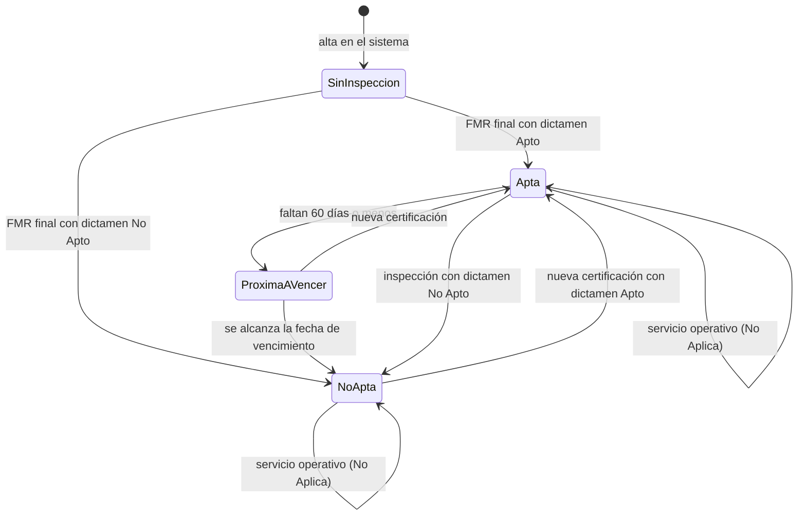
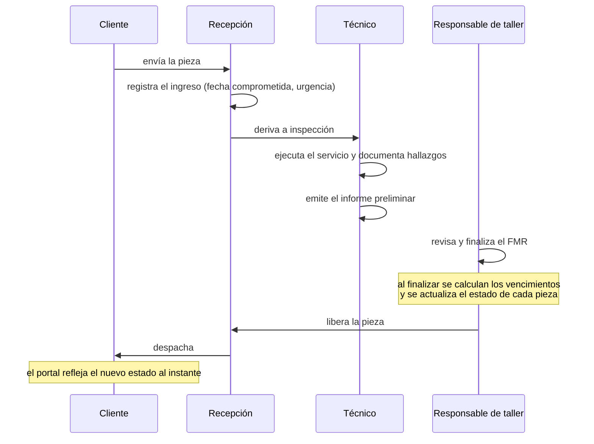
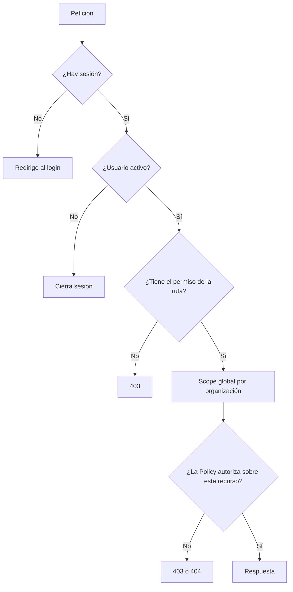

# Flujos de negocio

Reconstruidos a partir de la auditoría. Cada flujo indica qué está confirmado y qué es supuesto.

## 1. Ciclo de vida de una pieza



**Confirmado:** los cuatro estados, la ventana de 60 días y que los servicios «No Aplica» no alteran el estado.
**Supuesto (S1):** la vigencia exacta por tipo de servicio.

## 2. Proceso de inspección



**Confirmado:** las etapas de recepción, liberación y despacho; la existencia de informes preliminares y finales.
**Supuesto (S3):** quién libera y quién despacha.

## 3. Cómo se determina la aptitud

Es la regla más importante y la que el sistema actual declara de forma explícita.

```
Para cada pieza:
  1. Tomar todas sus líneas de FMR
  2. Descartar las de informes que no estén en estado final
  3. Descartar los resultados "No Aplica" y "Sin Procesar"
  4. De las que quedan, tomar la de fecha de inspección más reciente
     (ante empate, la de mayor identificador)
  5. Si no queda ninguna          → Sin inspección
     Si el dictamen es No Apto    → No apta
     Si es Apto y ya venció       → No apta
     Si es Apto y vence en ≤60 d  → Próxima a vencer
     En otro caso                 → Apta
```

Implementado en `App\Actions\RecalculateAssetStatus`, con diez pruebas que cubren cada rama.

**Punto que más se malinterpreta:** una intervención operativa posterior *no* invalida ni renueva el dictamen vigente. Una pieza certificada en enero y con un servicio operativo en julio sigue apta hasta el vencimiento de enero.

## 4. Pipeline de taller

Recorrido definido por el negocio (revisado el 27/09/2026):

```
ENVÍO   Borrador → Pendiente de recepción ─[Dar recepción]→ Recibido   (o Rechazado)

EN TALLER  (todo lo que no se despachó)
 Pendientes ─[Iniciar]→ En proceso ─[Aprobar]→ Listas para despachar ─[Despachar]→ Despachada
                            │
                        [Rechazar]
                            ↓
                       Rechazadas ─[Consultar]→ Esperando cliente ─ NO ─→ Listas para despachar (no apto)
                            │                          │
                     [Sin solución]                    SÍ
                            ↓                          ↓
         Listas para despachar (no apto)          Reparación ─[Iniciar]→ En proceso (reparación)
                                                                           ├─[Aprobar]→ Listas para despachar
                                                                           └─[Rechazar]→ Rechazadas (reparación fallida;
                                                                                          sólo "Sin solución")
```

- **Dar recepción:** el taller confirma lo que el cliente declaró en el envío. En ese momento se crea una recepción por equipo, en Pendientes.
- **Rechazadas:** dos salidas. Consultarle al cliente si autoriza la reparación (se le cobra, así que la decide él) o marcarla **sin solución** (lo decide el taller, con motivo obligatorio).
- **Consulta:** llega por correo a todos los usuarios de la organización y a su correo de contacto, con un enlace directo a la recepción. La respuesta se carga con sesión iniciada.
- **Reparación:** se intenta una sola vez. Iniciada, vuelve a En proceso y se aprueba o se rechaza como cualquier trabajo.
- **Sin reparar:** si el cliente no autoriza o no hay solución, el equipo vuelve como está y queda **no apto y sin vencimiento**.

«Pendiente» y «Fuera de plazo» se calculan comparando los hitos contra la fecha comprometida. Ninguna etapa es una columna: todas se derivan de los hitos registrados (`Reception::stage()`).

**Reglas aplicadas:** no se puede despachar algo rechazado sobre lo que nadie decidió nada, ni repetir un hito ya cumplido. Cada hito guarda quién y cuándo.

## 5. Alta de una cuenta

```mermaid
sequenceDiagram
    participant V as Visitante
    participant S as Sitio público
    participant A as Administrador

    V->>S: completa la solicitud (nombre, correo, empresa)
    S->>S: valida, aplica honeypot y límite por IP
    S->>A: la solicitud queda pendiente de revisión
    A->>A: revisa y decide
    alt Aprobada
        A->>A: asocia a una organización
        A->>A: crea el usuario con sus roles
        Note over A: contraseña aleatoria descartable;<br/>el usuario define la suya por correo
    else Rechazada
        A->>A: registra el motivo
    end
```

**Confirmado:** el formulario público no pide contraseña; el alta la hace un administrador.

Aprobar una solicitud **no crea el usuario automáticamente**: registra la decisión. El alta se hace desde *Usuarios*, deliberadamente, para que quede claro quién otorgó qué rol.

## 6. Aislamiento de datos



Un usuario de cliente queda confinado a su organización por el scope global; el personal interno de Odessa no, pero sus Policies siguen gobernando qué puede hacer.

Un recurso de otra organización devuelve **404, no 403**: no se confirma siquiera que exista.
