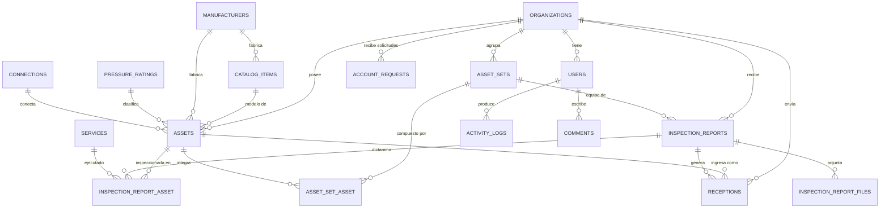

# Modelo de datos

Diseñado **después** de la auditoría, sobre las entidades que el sistema actual demostró tener. No se incluyeron tablas para módulos sin respaldo (inventario de materiales, técnicos, talleres múltiples).

## Diagrama

## Entidades

### `organizations` — empresa cliente
Raíz del aislamiento de datos. `short_code` reproduce la abreviatura que el sistema actual usa en la nomenclatura de los informes.

### `users`
`organization_id` **nulo** identifica al personal interno de Odessa; con valor, ata al usuario a una única organización. Incluye `last_login_at`, `last_login_ip`, `is_active` y campos cifrados de 2FA.

### `catalog_items` — catálogo de modelos
Separa el «qué es» del «cuál es». Corresponde a las tablas `Partes` y `Genericos` del sistema actual, unificadas por `kind`.

### `assets` — pieza física individual
Corresponde a `ClientesPartes` + `ClientesGenericos`. Se unificaron porque comparten ciclo de inspección, bitácora y estado.

Las columnas `status`, `expires_at` y `current_inspection_report_id` son **derivadas y desnormalizadas** para poder filtrar y ordenar sin subconsultas. La fuente de verdad es `inspection_report_asset`; las recalcula `RecalculateAssetStatus` y no admiten asignación masiva.

Incluye `workshop_description`, que reproduce el `descripcion_taller` observado: el taller identifica la pieza de forma distinta al cliente.

### `inspection_reports` — FMR
Cabecera del informe. `status` recorre `draft → preliminary → final`, con `cancelled` como salida. Sólo un informe **final** propaga vencimientos.

### `inspection_report_asset` — línea de dictamen
**La tabla más importante del modelo.** Cada fila es el dictamen de *una* pieza dentro de *un* informe, con su propio `result`, `service_id`, `expires_at` y `seal`. Esto reproduce exactamente lo observado: un mismo FMR con resultados distintos según la pieza.

El campo `seal` (precinto) vive aquí y no en `assets`, porque el sistema actual lo guarda en el registro de vencimiento: cambia con cada inspección.

### `inspection_report_files`
`path` apunta al disco privado. Se guarda `checksum` (sha256), `mime_type` real y `size_bytes`. Nunca hay una URL directa al archivo.

### `asset_sets` y `asset_set_asset`
Agrupaciones de piezas. `position` conserva el orden de armado del equipo.

### `receptions` — pipeline de taller
Hitos como marcas de tiempo (`released_at`, `dispatched_at`) con su responsable, en lugar de banderas booleanas: así queda registrado *cuándo* y *quién*, no sólo *si*.

«Pendiente» y «Vencido» se derivan contra `promised_at`; no se almacenan.

### `services`
`determines_fitness` es la columna que codifica la regla R4: distingue los servicios que emiten dictamen de los meramente operativos. `validity_days` permite una vigencia distinta por servicio, con el valor por defecto en configuración.

### `activity_logs`
Registro de auditoría, sólo inserción. `changes` guarda `{old, new}` filtrado contra una lista negra que elimina contraseñas, tokens y secretos.

### `account_requests`
Solicitudes públicas de acceso. Nunca incluye contraseña.

## Decisiones de diseño

| Decisión | Motivo |
|---|---|
| **UUID v7 público** en rutas | El sistema actual expone IDs secuenciales, que permiten enumerar el inventario completo |
| **Estado desnormalizado** en `assets` | Sin él, filtrar 800+ piezas por estado exige una subconsulta correlacionada por fila |
| **Piezas y genéricos en una tabla** | Comparten todo el ciclo de vida; separarlos duplicaría cada consulta y cada Policy |
| **Precinto en la línea de FMR** | Es un dato de la inspección, no de la pieza; así lo modela el sistema actual |
| **Hitos como timestamps** | Un booleano `liberado` pierde quién y cuándo |
| **Borrado lógico selectivo** | En organizaciones, activos, informes y usuarios (trazabilidad); no en la auditoría ni en las líneas de dictamen |
| **Sin repositorio genérico** | Eloquent con scopes explícitos es suficiente y más legible |

## Índices

Además de las claves primarias y foráneas:

- `assets`: `(organization_id, status)`, `(organization_id, expires_at)`, `(organization_id, kind)`, `serial_number`, `code`, único `(organization_id, kind, serial_number)`
- `inspection_reports`: `(organization_id, inspected_at)`, único `(organization_id, number)`
- `inspection_report_asset`: `(asset_id, result)`, único `(inspection_report_id, asset_id)`
- `receptions`: `(organization_id, released_at, dispatched_at)`, `promised_at`, `is_urgent`, `dispatched_at`
- `activity_logs`: `(organization_id, created_at)`, `(user_id, created_at)`, `action`

Los índices compuestos empiezan por `organization_id` porque **toda** consulta lleva ese filtro por el scope global.
